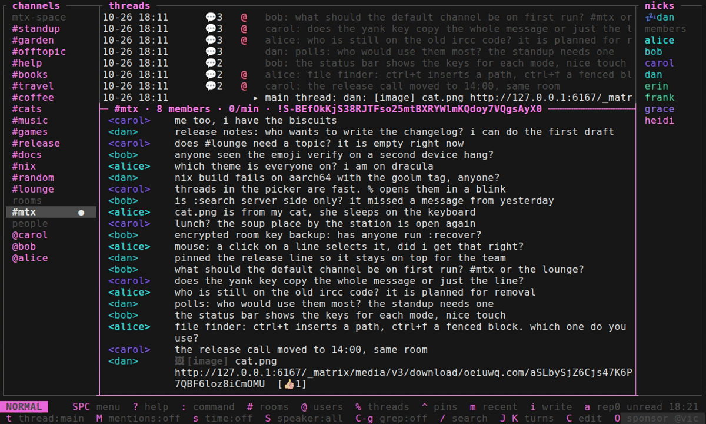

<p align="right">
  <a href="https://github.com/sponsors/vic"></a>
  <a href="https://github.com/vic/mtx/releases"></a>
  <a href="LICENSE"></a>
</p>

# {mtx}

A full-featured Matrix client for the terminal. Keys like helix and vim.



Download pre-built binary from [releases](https://github.com/vic/mtx/releases) or run directly with Nix:

```shell
nix run github:vic/mtx
```

Docs, keys and short demos: https://mtx.oeiuwq.com

Apache-2.0. Made with `<3` by [vic](https://x.com/oeiuwq).
